# PayFlow

**Multi-tenant payment & order management platform** — .NET 10 · React · PostgreSQL · RabbitMQ

PayFlow lets several companies (tenants) run customers, products, orders, payments, refunds and financial reporting on one SaaS platform, with strict data isolation between them. The focus is not CRUD but the hard parts of a real payment system: tenant isolation, idempotency, asynchronous processing, the transactional outbox/inbox, failure recovery, reconciliation, observability and tests that prove the behaviour.

> **No real money moves.** The payment provider is a deterministic simulator. PayFlow never accepts card numbers; it only takes provider test tokens such as `pm_test_success`.

| | |
|---|---|
| Backend | C# / .NET 10, ASP.NET Core Minimal APIs, EF Core 10 + Npgsql, FluentValidation, ASP.NET Core Identity, JWT |
| Messaging | RabbitMQ (publisher confirms, retry queues, DLQ), Transactional Outbox + Inbox |
| Database | PostgreSQL 17 — composite tenant-safe foreign keys, check constraints, partial unique indexes, Row-Level Security |
| Frontend | React 19 + Vite, MUI 7, MUI X Data Grid & Charts, TanStack Query, React Hook Form + Zod |
| Quality | xUnit v3, Testcontainers, WebApplicationFactory, NetArchTest, Playwright, Vitest, k6 |
| Operations | Docker Compose, GitHub Actions, OpenTelemetry → Prometheus / Tempo / Loki / Grafana |
| AI (advanced) | Read-only reporting assistant on Claude with four allowlisted, tenant-scoped tools |

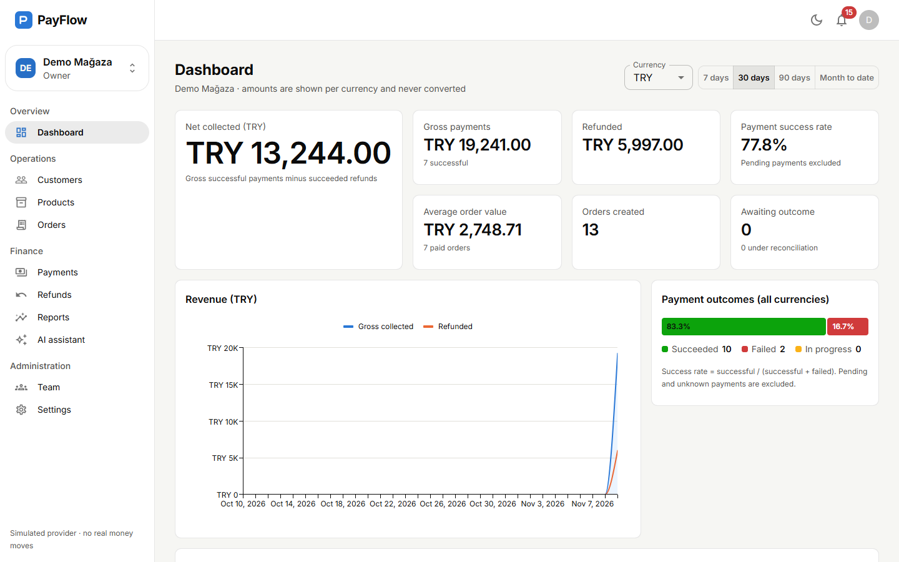

▶ **[Demo video](docs/media/payflow-demo.webm)** (1 min, WebM): sign in, create an order, take a payment, refund part of it,
read the order history. More in [Screenshots](#screenshots).

---

## Contents

1. [Quick start](#quick-start) · [Hızlı başlangıç (TR)](#hızlı-başlangıç-tr) · [Screenshots](#screenshots)
2. [Architecture](#architecture)
3. [Payment processing](#payment-processing)
4. [Multi-tenancy & security](#multi-tenancy--security)
5. [Data model](#data-model)
6. [API](#api)
7. [Testing](#testing)
8. [Observability & operations](#observability--operations) · [Performance baseline](#performance-baseline)
9. [AI reporting assistant](#ai-reporting-assistant)
10. [Project structure](#project-structure)
11. [Design decisions (ADRs)](#design-decisions-adrs)
12. [Known limitations](#known-limitations)

---

## Quick start

### Option A — Docker Compose (everything)

```bash
cp .env.example .env            # optional: override local secrets
docker compose up --build
```

| URL | What |
|---|---|
| http://localhost:8080 | Web app (React, served by nginx, `/api` proxied) |
| http://localhost:5080/scalar | API reference (OpenAPI + Scalar) |
| http://localhost:15672 | RabbitMQ management (guest / guest) |

With traces, metrics and logs:

```bash
OTEL_EXPORTER_OTLP_ENDPOINT=http://otel-collector:4317 docker compose --profile observability up --build
# Grafana: http://localhost:3000  ->  "PayFlow - Operations" dashboard, Tempo traces, Loki logs
```

The compose file mirrors production choices: a one-shot **migrator** applies migrations with the owner role, while the API and Worker connect as the least-privileged `payflow_app` role with **PostgreSQL Row-Level Security** enforced.

**Demo data** (optional) is created through the public API, like a user would:

```bash
node scripts/seed-demo.mjs        # PAYFLOW_URL=http://localhost:5080 for Option B
```

| Sign in | Password | Company |
|---|---|---|
| `demo@payflow.local` | `PayFlow2026` | **Demo Mağaza** (TRY): 5 customers, 5 products, 10 orders, payments in every provider outcome, a partial and a full refund, a pending invitation |
| `demo-b@payflow.local` | `PayFlow2026` | **Globex Ltd** (EUR): a second tenant for the isolation demo |

Re-running the script is safe; existing demo companies are left untouched.

### Option B — Local development

Prerequisites: .NET 10 SDK, Node.js 22, PostgreSQL 17, RabbitMQ (or the in-memory transport).

```bash
# 1. Infrastructure (or point the connection strings at your own servers)
docker compose up -d postgres rabbitmq

# 2. API (applies migrations on startup in Development)  -> http://localhost:5080/scalar
dotnet run --project src/PayFlow.Api

# 3. Worker (outbox publisher, consumers, reconciliation, mock provider)
dotnet run --project src/PayFlow.Worker
#    no RabbitMQ? run the same pipeline in-process:
Messaging__Transport=InMemory dotnet run --project src/PayFlow.Worker

# 4. Web app  -> http://localhost:5173 (Vite proxies /api to the API)
cd frontend/payflow-web && npm install && npm run dev
```

### Try it

1. Register, create a company, add a customer and a product (e.g. `1500.75 TRY`).
2. Create an order and **Take payment**. Pick a test token and watch the payment page update:

| Token | Behaviour |
|---|---|
| `pm_test_success` | Succeeds |
| `pm_test_decline` | Definitive decline (`card_declined`), never retried |
| `pm_test_timeout` | Charge executes but the response is "lost" → `Unknown` → reconciled via the provider status API, **no second charge** |
| `pm_test_pending` | Provider confirms later with an HMAC-signed webhook |
| `pm_test_error` | Transient error on attempt 1, automatic retry (new attempt, backoff + jitter) succeeds |
| `pm_test_error_persistent` | Fails after the per-run retry budget; can be retried manually |

3. Refund part of the payment, then check the dashboard and reports.

A scripted 5-minute demo (including stopping RabbitMQ and cross-tenant access attempts) is in [docs/demo.md](docs/demo.md). Request examples: [src/PayFlow.Api/PayFlow.Api.http](src/PayFlow.Api/PayFlow.Api.http).

### Hızlı başlangıç (TR)

```bash
docker compose up --build        # Web: http://localhost:8080  ·  API dokümanı: http://localhost:5080/scalar
```

Docker yoksa: PostgreSQL ve (isteğe bağlı) RabbitMQ'yu kendiniz çalıştırın, ardından `dotnet run --project src/PayFlow.Api`, `dotnet run --project src/PayFlow.Worker` (RabbitMQ yoksa `Messaging__Transport=InMemory`) ve `frontend/payflow-web` içinde `npm install && npm run dev`. Kayıt olun, şirket oluşturun, müşteri/ürün/sipariş ekleyin ve yukarıdaki test token'larıyla ödeme senaryolarını deneyin. Hazır örnek veri için `node scripts/seed-demo.mjs` çalıştırıp `demo@payflow.local` / `PayFlow2026` ile giriş yapabilirsiniz. Ayrıntılı demo akışı: [docs/demo.md](docs/demo.md).

### Screenshots

| | |
|---|---|
| 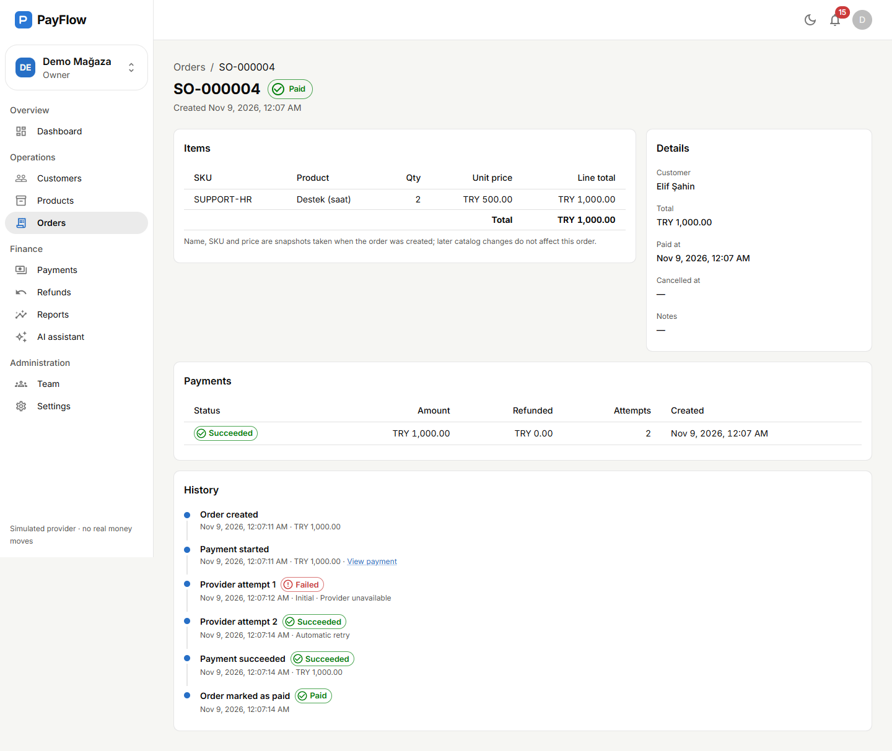 **Order history**: a transient provider error on attempt 1, the automatic retry, success | 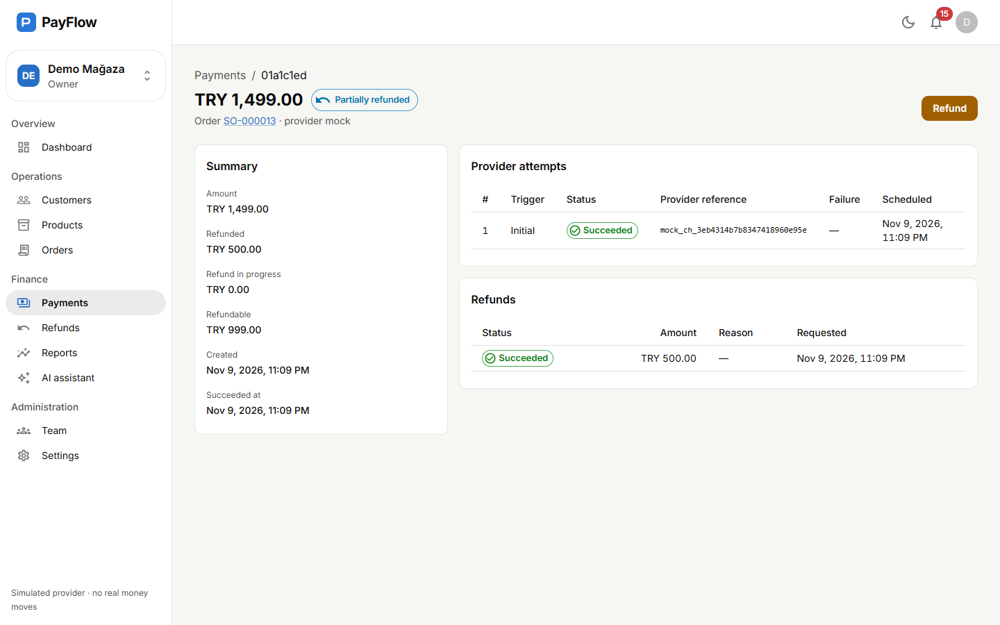 **Payment detail**: provider attempts, refunds, refundable amount |
| 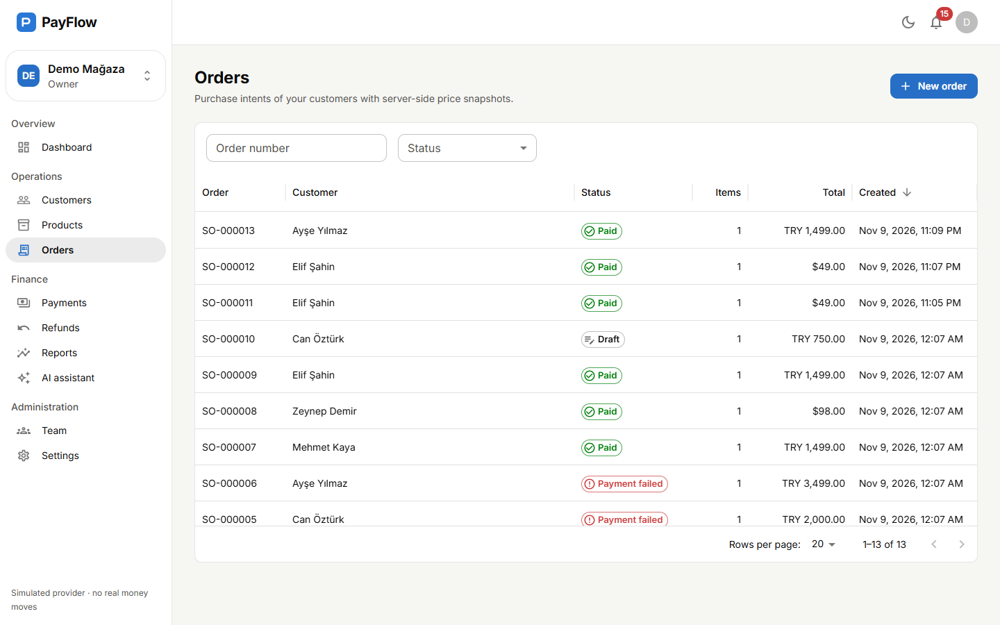 **Orders**: server-side paging, filters and allowlisted sorting | 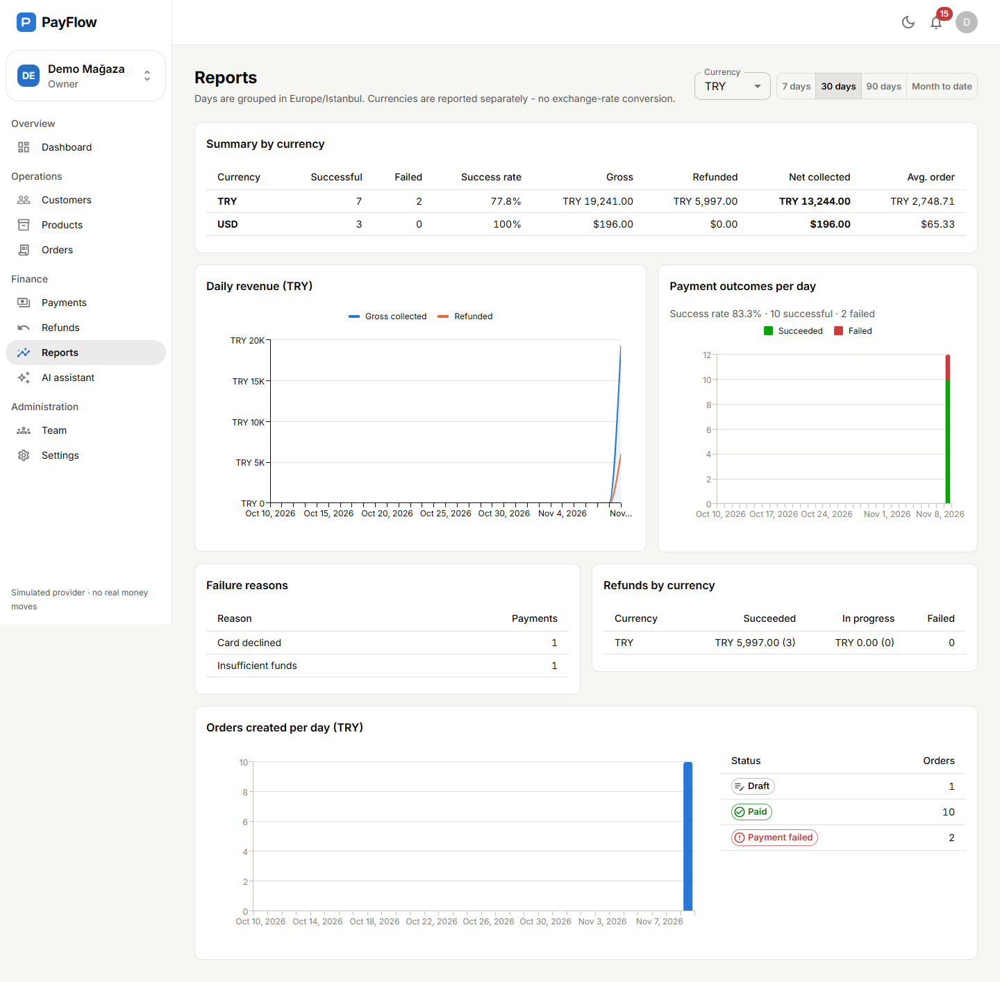 **Reports**: per-currency figures, never converted, with table views behind every chart |
| 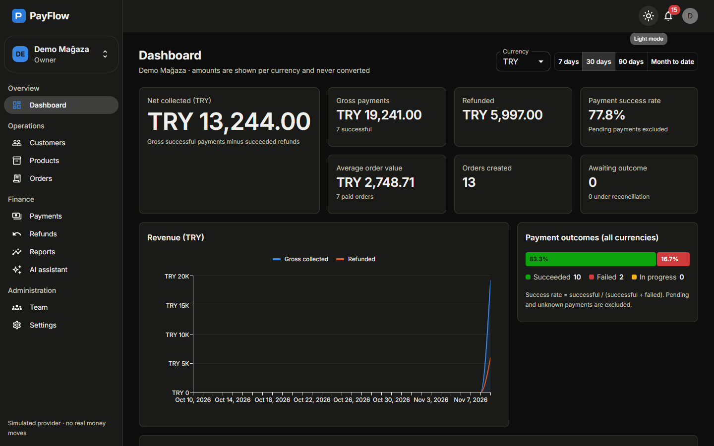 **Dark mode** with its own validated palette | 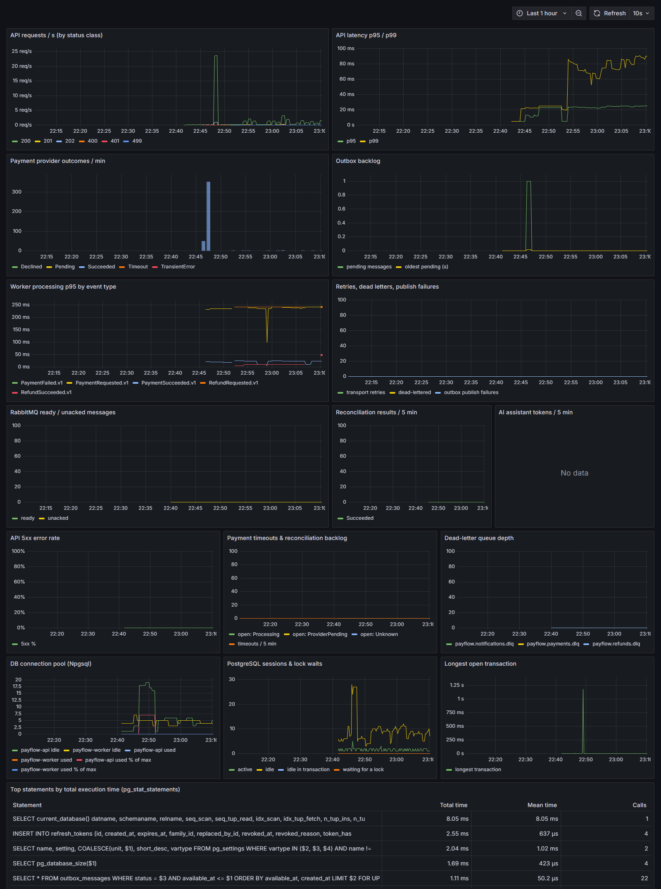 **Grafana**: API, payments, outbox, queues, worker and database |

The screenshots and the demo video are generated from the demo data by an opt-in browser test, so they can be refreshed after UI changes:
`PAYFLOW_E2E_BASE_URL=http://localhost:8080 PAYFLOW_E2E_CAPTURE_DIR=$PWD/docs dotnet test tests/PayFlow.EndToEndTests --filter ReadmeMediaTests`.

---

## Architecture

A **modular monolith** with a separately deployed **Worker** process. Both share the same code base and database; modules talk through narrow application APIs and integration events, never through each other's tables.

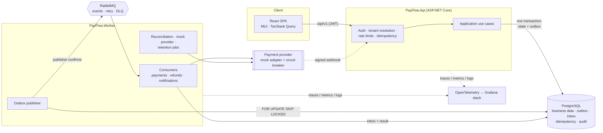

**Layers and dependency rules** (enforced by architecture tests):

| Project | May reference | Contains |
|---|---|---|
| `PayFlow.Domain` | nothing | Aggregates, value objects, invariants, state machines, domain events |
| `PayFlow.Application` | Domain | Use cases, ports (`IPaymentProvider`, `IIdempotencyStore`, …), validation, authorization rules |
| `PayFlow.Infrastructure` | Application, Domain, Contracts | EF Core, PostgreSQL, RabbitMQ, Identity/JWT, provider adapters, OpenTelemetry |
| `PayFlow.Contracts` | nothing | Versioned integration events (`PaymentRequested.v1`, …) |
| `PayFlow.Api` / `PayFlow.Worker` | Application, Infrastructure | Composition roots (HTTP / background processing) |

**Module boundaries.** One `DbContext` implements a narrow interface per module (`IOrdersDb`, `IPaymentsDb`, …), so a module cannot even compile code against another module's tables. Payments uses the Orders module's public API (`IOrderPaymentCoordinator`) and implements an Orders-owned port (`IOrderPaymentsPort`) — Orders never depends on Payments. More detail: [docs/architecture/overview.md](docs/architecture/overview.md).

---

## Payment processing

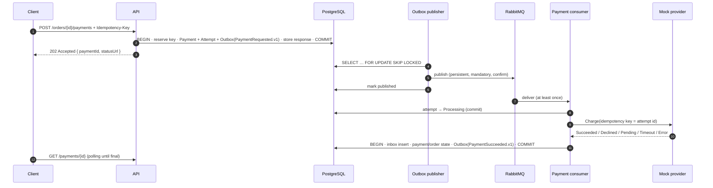

Key properties:

- **Amounts never come from the client.** The server reads catalog prices, snapshots them into order items and computes the total.
- **Idempotency in the same transaction.** The key reservation, the business change and the stored response commit together. A concurrent duplicate blocks on the unique index and then replays the stored response; the same key with a different body returns `409`.
- **Defence against double charges at three levels:** idempotency keys (API), a partial unique index allowing one live payment per order (database), and the attempt id as provider idempotency key (provider).
- **Transactional outbox.** Broker down? Payments are still accepted (202) and the event waits in PostgreSQL with back-off until RabbitMQ is back.
- **Inbox + business idempotency.** Duplicate deliveries are absorbed by `inbox_messages` (consumer, message id) in the same transaction as the effect, plus state checks in the aggregates.
- **Timeouts are `Unknown`, never `Failed`.** Reconciliation asks the provider for the authoritative status; a new charge is only scheduled if the provider confirms it never received the request.
- **Retries.** Transient provider errors create a *new attempt* with exponential backoff + jitter (delayed through `outbox.available_at`); declines are never retried. Transport failures go to per-level retry queues, then to a dead-letter queue. A Polly circuit breaker stops calling an unhealthy provider.
- **Webhooks** are verified (HMAC-SHA256 over timestamp + body, 5-minute replay window), deduplicated by `(provider, provider_event_id)`, matched by provider reference, and checked against amount and currency. Backward transitions are rejected by the state machine.
- **Refunds** take a row lock on the payment and reserve the amount, so concurrent refunds can never exceed the captured amount (also guarded by a check constraint).

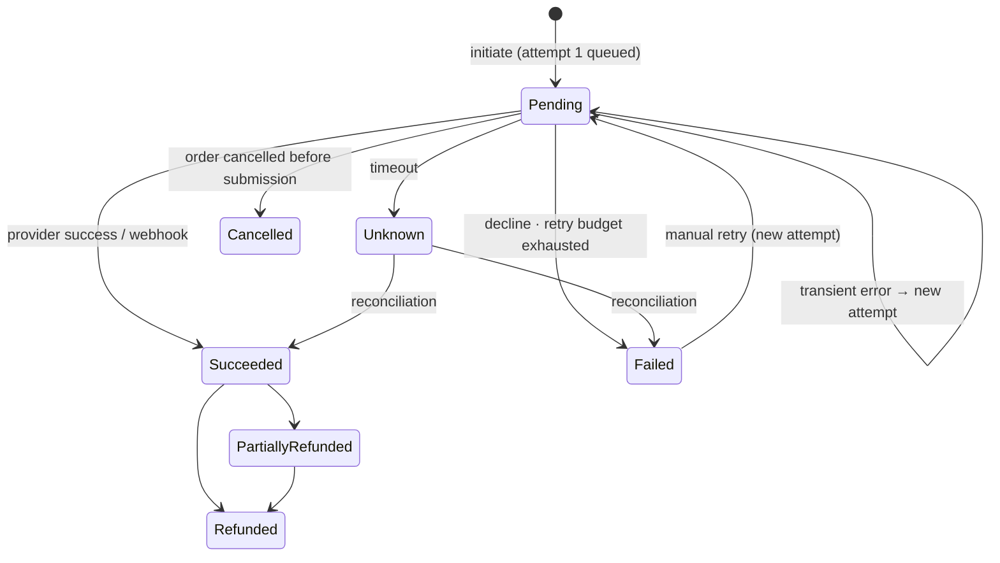

---

## Multi-tenancy & security

Shared database, shared schema, `tenant_id` on every business row — with **defence in depth**:

1. **Server-side tenant context.** The active tenant comes from a token claim *and* a live membership check on every request. A disabled or downgraded membership loses access on the next request. `X-Tenant-Id` headers or `tenantId` body fields are ignored.
2. **Global EF Core query filters** on tenant tables, failing closed when no tenant is set, plus a write guard that refuses to save rows of another tenant.
3. **Tenant-safe composite foreign keys** — `orders (tenant_id, customer_id) → customers (tenant_id, id)` — so even buggy code cannot link rows across tenants.
4. **PostgreSQL Row-Level Security** for the application role (`app.tenant_id` is set per command by an EF interceptor; pooled connections are reset by Npgsql).
5. **404 for other tenants' resources** — existence is never disclosed.

**Platform staff** (spec §2.1) are configured by email (`Platform:Admins`, `Platform:SupportAgents`). A PlatformAdmin lists tenants and suspends/reactivates them with an audited reason; a SupportAgent can only list. Suspension blocks every member on the next request. Platform roles never grant access to a tenant's customers, orders or payments. There is no email verification yet, so configure only addresses whose accounts you created yourself.

Other controls: permission-based policies per endpoint (the role matrix of the spec, [Permissions.cs](src/PayFlow.Application/Authorization/Permissions.cs)); privilege-escalation and last-owner protection; ASP.NET Core Identity password policy and lockout; generic login errors; 15-minute access tokens kept **in memory** by the SPA; refresh tokens stored as SHA-256 hashes, rotated on every use, delivered in an **HttpOnly, SameSite=Strict, path-scoped cookie**, with reuse detection that revokes the whole token family; rate limits (login, global, assistant); request size limits; RFC 7807 errors without internals; security headers; append-only audit trail with correlation ids and no secrets. Threat model: [docs/security/threat-model.md](docs/security/threat-model.md).

---

## Data model

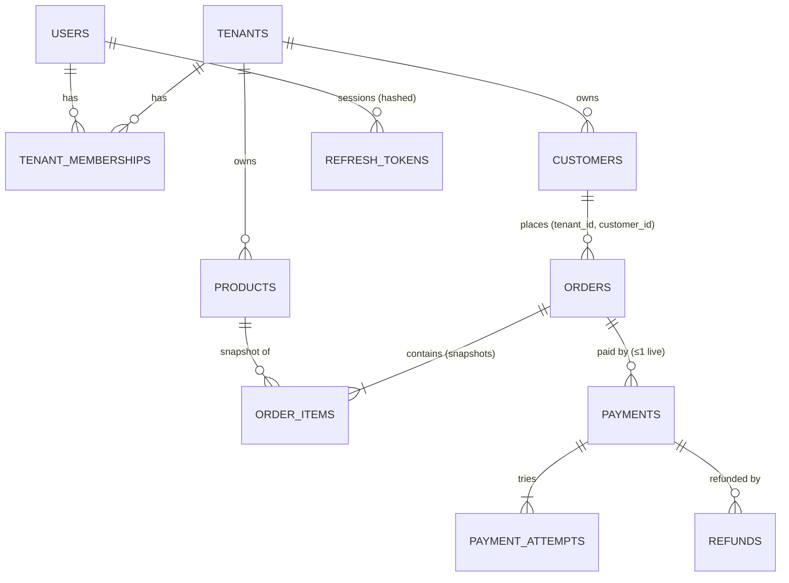

Money is always `BIGINT` minor units with an ISO 4217 currency (`1500,75 TRY → 150075`); currencies are never summed together. Timestamps are `timestamptz` (UTC); reports bucket days in the tenant's time zone. Full table catalogue, constraints and indexes: [docs/database/schema.md](docs/database/schema.md).

---

## API

Base path `/api/v1`, JSON, RFC 7807 problem details with a stable `code`, OpenAPI at `/openapi/v1.json` (UI: `/scalar`).

| Area | Endpoints |
|---|---|
| Auth | `POST /auth/register` · `/login` · `/refresh` · `/logout` · `GET /auth/me` · `/memberships` · `POST /auth/activate-tenant` · `GET /auth/invitations` · `POST /auth/invitations/{id}/accept` |
| Tenant | `POST /tenants` · `GET/PATCH /tenants/current` · members, invitations |
| Catalog | `/customers` (CRUD, soft delete) · `/products` (CRUD, status) |
| Orders | `POST/GET /orders` · `GET /orders/{id}` · `PATCH /orders/{id}/cancel` · `GET /orders/{id}/payments` |
| Payments | `POST /orders/{id}/payments` (202) · `GET /payments` · `/payments/{id}` · `/attempts` · `POST /payments/{id}/retry` · `POST/GET /payments/{id}/refunds` · `GET /refunds` |
| Webhooks | `POST /webhooks/payments/mock` (signed) |
| Reports | `GET /reports/overview` · `/revenue` · `/payments` · `/refunds` · `/orders` |
| Platform | `GET /platform/tenants` · `PATCH /platform/tenants/{id}/status` (PlatformAdmin / SupportAgent) |
| Other | `GET /notifications` · `GET /audit-logs` · `GET /assistant/status` · `POST /assistant/ask` |

| Situation | Status |
|---|---|
| Missing/invalid token | 401 |
| Authenticated but not allowed / no active tenant | 403 (`permission_denied`, `tenant_required`, `tenant_access_revoked`) |
| Resource of another tenant | 404 |
| Validation | 400 with field errors |
| Idempotency key reused with another body · concurrency conflict · invalid state transition | 409 |
| Payment / refund accepted | 202 |

---

## Testing

| Layer | Tool | What it proves | Count |
|---|---|---|---|
| Unit | xUnit v3 + Shouldly | Domain invariants and state machines, money arithmetic, role matrix, backoff, webhook signatures, outbox mapping, assistant tool safety | 91 |
| Architecture | NetArchTest | Layer dependencies, module boundaries, no public setters on entities | 13 |
| Integration | WebApplicationFactory + **real PostgreSQL** (Testcontainers) | Auth & refresh rotation, tenant isolation, RBAC, idempotency under concurrency, all payment scenarios, webhooks, refunds under concurrency, broker outage, duplicate delivery, composite FKs, RLS (incl. the full app under RLS), platform administration, order history, request time budget (504) | 61 |
| Messaging | Testcontainers RabbitMQ | Publisher confirms, routing, delayed retry queue round trip, dead-lettering, unroutable messages | 4 |
| E2E | Playwright (.NET) | Register → company → customer → product → order → payment → refund → dashboard → reports in a browser; platform admin suspends/reactivates a tenant; unauthenticated redirect | 3 |
| Accessibility | Playwright + axe-core | WCAG 2.1 A/AA automated rules on 16 screens and states, including dialogs and dark mode — zero violations | 1 |
| Frontend | Vitest + Testing Library | Minor-unit money parsing/formatting, status chips, sign-in company selection, order history, label contrast | 25 |
| Load | k6 + `EXPLAIN (ANALYZE, BUFFERS)` | p95/p99 and error rate for reads and payment initiation; query plans at 100 000 orders | [results](#performance-baseline) |

```bash
dotnet test tests/PayFlow.UnitTests
dotnet test tests/PayFlow.ArchitectureTests
dotnet test tests/PayFlow.IntegrationTests          # needs Docker, or PAYFLOW_TEST_POSTGRES=<admin connection string>
PAYFLOW_E2E_BASE_URL=http://localhost:8080 dotnet test tests/PayFlow.EndToEndTests   # + PAYFLOW_E2E_PLATFORM_ADMIN=<email in Platform:Admins>
cd frontend/payflow-web && npm test
# load test and query plans: see docs/performance/baseline.md
```

The integration suite never uses the EF InMemory provider. Concurrency tests fire real parallel HTTP requests (e.g. 8 identical idempotent payment requests → exactly one payment; 6 concurrent 3 000-unit refunds on a 10 000 payment → exactly three succeed).

---

## Observability & operations

- **Traces:** HTTP request → use case → SQL → outbox publish → RabbitMQ → consumer → provider call, in **one trace** (the outbox stores the W3C `traceparent` of the originating request).
- **Metrics:** request rate/latency/5xx rate, provider outcomes, payment timeouts and the reconciliation backlog (open attempts by status), outbox backlog and oldest pending age, retries, dead letters, per-queue depth including dead-letter queues, reconciliation results, processing duration, assistant tokens/latency.
- **Database:** Npgsql connection-pool usage per service; `postgres-exporter` (read-only `pg_monitor` role) for sessions by state, sessions waiting for locks, the longest open transaction and the top statements from `pg_stat_statements`.
- **Logs:** structured JSON with correlation id, tenant id, trace id; no secrets or card data.
- **Health:** `/health/live` and `/health/ready` (PostgreSQL; Worker also RabbitMQ and an outbox heartbeat). Containers use `--healthcheck` mode (no curl in the image).
- **Time budget:** every API request is cancelled after 30 s (assistant: 120 s) and answered with `504 request_timeout`, so no request holds a connection or a transaction indefinitely.
- **Alerts** (10 rules in [alerts.yml](infrastructure/monitoring/alerts.yml)) link to runbooks: [outbox backlog](docs/runbooks/outbox-backlog.md), [dead-letter queue](docs/runbooks/dead-letter-queue.md), [unknown payments](docs/runbooks/unknown-payments.md), [database pressure](docs/runbooks/database.md), [incident response](docs/runbooks/incident-response.md), [deploy & rollback](docs/runbooks/deploy-and-rollback.md).
- **CI/CD** ([ci.yml](.github/workflows/ci.yml)): build with warnings as errors, vulnerable-package check, unit/architecture/integration tests, frontend lint/test/build/audit, secret scanning, container images (GHCR on `main`), docker-compose + Playwright E2E and accessibility scan, demo-data seeding, gated staging deployment.

### Performance baseline

Measured with k6 on a developer machine (Docker Desktop, 16 vCPU), 20 concurrent readers plus 5 payments per second for one minute. Not an SLA; the method and the full numbers are in [docs/performance/baseline.md](docs/performance/baseline.md).

| | p50 | p95 | p99 | Errors |
|---|---|---|---|---|
| Read endpoints (orders, payments, customers) | 8 ms | **23 ms** | 47 ms | 0 % |
| Payment initiation (202) | 10 ms | 26 ms | 58 ms | 0 % (301 / 301 accepted) |

During the run the outbox never held more than one message, no queue built up, no session waited for a lock and every payment finished `Succeeded`. Query plans at 100 000 orders per tenant (as `payflow_app` with RLS): first page of orders 0.6 ms, payments with attempts 0.3 ms, outbox poll with a 50 000-message backlog 0.1 ms.

---

## AI reporting assistant

An optional, **read-only** assistant answers questions such as *"How did the payment success rate change this month?"*. It runs on Claude (default model `claude-opus-5-5`) and can only call four allowlisted tools — revenue, payment statistics, failed-payment summary, refund summary — which execute tenant-scoped report queries.

- The tenant always comes from the verified request context; tool inputs with extra fields (e.g. a smuggled `tenantId`) are rejected.
- Dates are validated and capped at 92 days; results are size-limited and carry metric definitions and the period.
- No SQL, no writes, no authorization decisions by the model; tool results are treated as data, not instructions.
- Refusals are handled, server-side refusal fallback is enabled, tokens and latency are measured.

Enable with `Assistant__ApiKey=<Anthropic API key>` (or `ANTHROPIC_API_KEY` in `.env` for Docker). Without a key the feature is disabled and the rest of PayFlow is unaffected. Details and evaluation set: [docs/ai/assistant.md](docs/ai/assistant.md).

---

## Project structure

```
PayFlow/
├── src/
│   ├── PayFlow.Domain/          aggregates, invariants, state machines
│   ├── PayFlow.Application/     use cases per module, ports, validation, authorization
│   ├── PayFlow.Infrastructure/  EF Core + migrations, RabbitMQ, Identity/JWT, provider adapters, OpenTelemetry
│   ├── PayFlow.Contracts/       versioned integration events
│   ├── PayFlow.Api/             Minimal API endpoints, middleware, idempotency filter
│   └── PayFlow.Worker/          outbox publisher, consumers, background jobs
├── frontend/payflow-web/        React + Vite + MUI admin panel
├── tests/                       Unit · Integration · Architecture · EndToEnd (+ accessibility) · load (k6, SQL plans)
├── scripts/                     seed-demo.mjs (demo data through the public API)
├── infrastructure/              postgres init, OpenTelemetry / Prometheus / Grafana / postgres-exporter config
├── docs/                        architecture, database, ADRs, runbooks, security, AI, performance, demo, images
├── docker-compose.yml
└── .github/workflows/ci.yml
```

---

## Design decisions (ADRs)

| ADR | Decision |
|---|---|
| [001](docs/adr/ADR-001-modular-monolith.md) | Modular monolith + separate worker |
| [002](docs/adr/ADR-002-shared-database-schema.md) | Shared database, shared schema, `tenant_id` |
| [003](docs/adr/ADR-003-tenant-isolation.md) | Tenant isolation in depth (context, filters, composite FKs, RLS) |
| [004](docs/adr/ADR-004-payment-idempotency.md) | Idempotency keys stored in the business transaction |
| [005](docs/adr/ADR-005-transactional-outbox.md) | Transactional outbox with delayed availability |
| [006](docs/adr/ADR-006-inbox-at-least-once.md) | Inbox and at-least-once delivery |
| [007](docs/adr/ADR-007-provider-abstraction.md) | Provider abstraction, mock provider, resilience |
| [008](docs/adr/ADR-008-money-representation.md) | Money as minor units + currency |
| [009](docs/adr/ADR-009-async-payment-api.md) | Asynchronous payment API (202 + polling) |
| [010](docs/adr/ADR-010-token-storage.md) | Access token in memory, refresh token in HttpOnly cookie |

---

## Verified end to end

On Docker Desktop (Windows 11, WSL 2) with `docker compose --profile observability up --build`: all containers healthy; migrations applied by the one-shot migrator; API/Worker connected as `payflow_app` with RLS on 9 tables; all six payment scenarios plus refunds over real RabbitMQ and signed container-to-container webhooks; RabbitMQ stopped mid-demo → payment accepted (202), event kept in the outbox, published ~24 s after the broker returned; Playwright journey through nginx; all 61 integration tests with Testcontainers (PostgreSQL + RabbitMQ); traces in Tempo, logs in Loki, metrics in Prometheus and the provisioned Grafana dashboard (API p95 ≈ 110 ms locally). Later on the same setup: the k6 baseline and query plans above, the axe-core accessibility scan with zero WCAG 2.1 A/AA violations, and the demo-data script on a fresh and on an existing database.

## Known limitations

- The payment provider is simulated; a real provider must be integrated through its sandbox, hosted checkout and tokenization.
- One live payment per order; split or multi-capture payments are out of scope (spec §7.4).
- Invitations are accepted in-app (no email delivery yet); notifications are in-app only.
- Platform roles come from configured emails and accounts have no email verification yet: register the platform accounts yourself before listing them (use SSO / verified email in production).
- Staging deployment is a gated placeholder in CI — the target platform is not chosen.
- List pages show a total count, which costs a scan of the tenant's rows (15 ms at 100 000 orders, growing linearly). Very large tenants would need keyset pagination or estimated totals ([baseline](docs/performance/baseline.md)).
- The AI assistant is tested with scripted and fake models (tool safety, tenant scoping, time budget); it needs an Anthropic API key to run against the real model, which CI does not have.
- Automated accessibility checks (axe-core) cover only part of WCAG; keyboard-only and screen-reader passes are manual.
