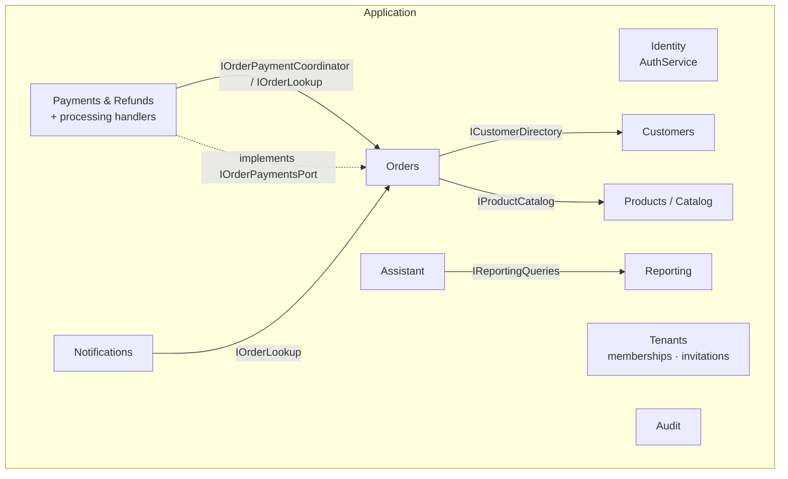
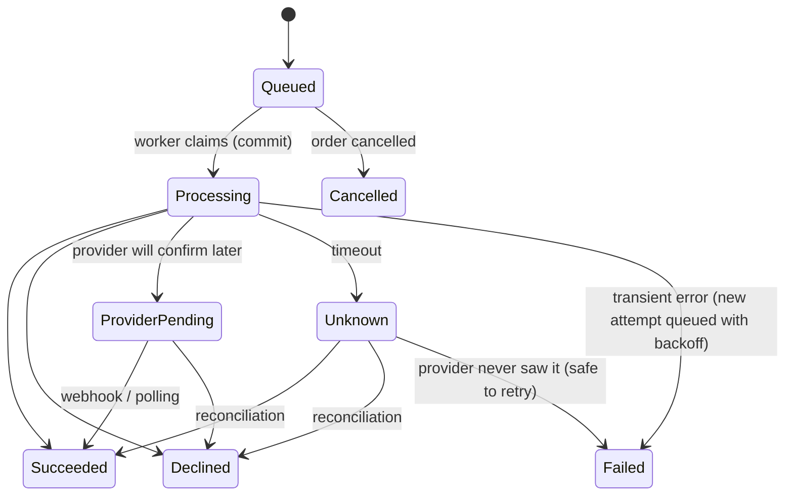

# Architecture overview

## Runtime view

| Process | Responsibilities | Scales by |
|---|---|---|
| **PayFlow.Api** | HTTP boundary: authentication, tenant resolution, authorization, validation, idempotency, use cases, webhooks, reports, assistant | Replicas behind a load balancer (stateless) |
| **PayFlow.Worker** | Outbox publisher, consumers (payments, refunds, notifications), reconciliation, mock provider simulation, retention | Replicas (outbox uses `SKIP LOCKED`, consumers share queues) |
| **PostgreSQL** | Source of truth: business data, outbox/inbox, idempotency keys, audit log | Vertical, then read replicas / partitioning |
| **RabbitMQ** | Durable delivery between outbox and consumers; retry and dead-letter queues | Quorum queues / cluster |
| **Web (nginx)** | Serves the SPA, proxies `/api` (same origin for the refresh cookie) | Replicas / CDN |

## Request pipeline (API)

```
ExceptionHandler → SecurityHeaders → CorrelationId → IdempotencyBuffering → CORS
→ Authentication (JWT) → TenantResolution (live membership check) → RateLimiter → Authorization (permission policies)
→ Endpoint filters (validation → idempotency) → Use case → EF Core (query filters, tenant guard, row versions, outbox)
```

## Module map



Rules (checked by `tests/PayFlow.ArchitectureTests`):
- Orders never references Payments; Customers/Catalog never reference Orders/Payments.
- Payments never touches `IOrdersDb`/`ICustomersDb` or the `Order` entity directly.
- Domain modules do not reference each other (Refunds may use the Payment aggregate it refunds).

## Consistency model

| Interaction | Mechanism | Consistency |
|---|---|---|
| Payment + attempt + order status + outbox | One local transaction | Atomic |
| API → Worker | Outbox → RabbitMQ (at least once) → inbox | Eventually consistent, exactly-once effects |
| Worker → provider | Idempotency key = attempt id; timeouts reconciled | No double charge |
| Provider → PayFlow | Signed webhook, event-id dedup, amount check, state machine | Idempotent, order-tolerant |
| Refund limit | Row lock on payment + reservation + check constraint | Serializable per payment |
| Concurrent edits | `row_version` optimistic concurrency → 409 | No lost updates |

## Payment attempt lifecycle



A *run* is the initial attempt or a manual retry plus its automatic retries (max 3 per run, 10 per payment).

## Failure handling summary

| Failure | Behaviour |
|---|---|
| RabbitMQ down | API keeps accepting (202); outbox rows wait with backoff; published after recovery |
| Worker crash mid-payment | Message redelivered; attempt in `Processing` is re-sent with the same idempotency key; stuck attempts are reconciled after 2 min |
| Provider timeout | Attempt `Unknown`; reconciliation queries status; never a blind second charge |
| Provider transient error | New attempt with exponential backoff + jitter (delayed outbox message) |
| Provider unhealthy | Circuit breaker opens; attempts fail fast as `provider_circuit_open` and are retried later |
| Poison message | Retry queues (5 s / 30 s / 2 min), then DLQ + alert; non-retryable errors go straight to DLQ |
| Duplicate webhook | Ignored by unique `(provider, provider_event_id)` |
| Out-of-order webhook | Rejected by the payment state machine (recorded as `Rejected`) |

## Observability

Every span carries `payflow.tenant_id` and the correlation id. The outbox stores the originating `traceparent`, so a single trace shows: HTTP request → EF Core / SQL → outbox publish → RabbitMQ → consumer → provider call → result transaction.
